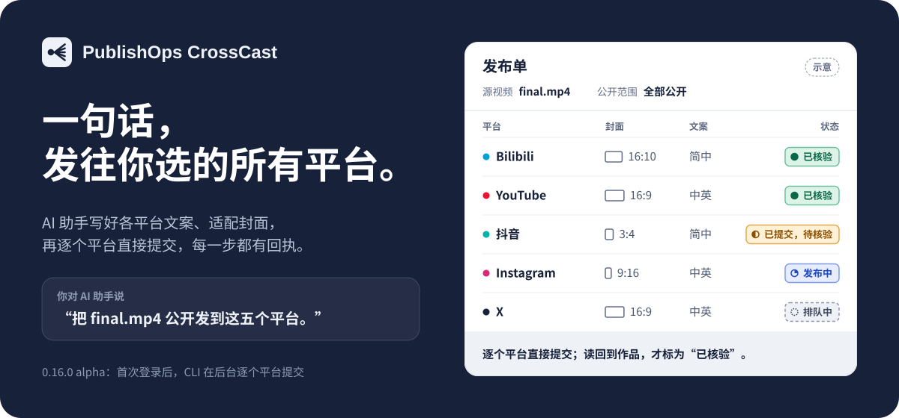

<p align="center">
  <b>简体中文</b> · <a href="README_ZH_TW.md">繁體中文</a> · <a href="README_EN.md">English</a>
</p>

<p align="center">
  
</p>

<h1 align="center">PublishOps CrossCast</h1>

<p align="center">
  <b>一句话，发往你选的所有平台。</b><br>
  你的 AI 助手为每个平台写好标题和简介、适配好封面；首次登录之后，CLI 在后台逐个平台提交，每一步都留下回执。
</p>

<p align="center">
  
  
  
  <a href="LICENSE"></a>
</p>

<p align="center">
  <a href="#-一句话开始">一句话开始</a> ·
  <a href="#-它能帮你做什么">能做什么</a> ·
  <a href="#-平台支持">平台支持</a> ·
  <a href="#-安全护栏">安全护栏</a> ·
  <a href="#-安装">安装</a> ·
  <a href="#-常见问题">常见问题</a> ·
  <a href="https://whitecarp.github.io/publishops-crosscast/">在线介绍</a>
</p>

> [!IMPORTANT]
> **0.16.0 alpha。** YouTube、抖音、Instagram、X 都已真实发布并读回过，B站也用 bili-cli 上传并核验过（部分来自更早的版本），详见[验证记录](docs/VALIDATION.md)。它仍是 alpha：登录会过期，平台也可能临时要求验证，长时间无人值守还没验收。

## 🚀 一句话开始

把下面这段话发给你的 AI 助手（Codex、Claude Code 这类能执行命令的助手都行），把 `final.mp4` 换成你的视频：

```text
请安装 https://github.com/whitecarp/publishops-crosscast
读取 skills/publishops-crosscast/SKILL.md，然后运行 vpub doctor。
把 final.mp4 公开发布到 B站、YouTube、抖音、Instagram 和 X，标题和简介按平台来写。
```

**开始前准备好这几样：**

- **B站**：用 B站 App 扫码登录一次（通过 bili-cli）。
- **YouTube**：免费发布通过专用 Chrome 在后台操作 YouTube Studio，只有登录或 Google 要求验证时才会看到浏览器。用 CLI 走官方 API 需要付费的 API 附加组件，以及你自己的 Google 桌面 OAuth 客户端。
- **抖音、Instagram、X**：第一次会打开 CrossCast 专用的官方 Chrome 窗口，你自己扫码或输入密码、验证码；之后 CLI 在后台复用这个登录。
- **X**：只能用 Media Studio 发布，账号必须已订阅并能进入 Media Studio。
- **可能会有“新设备”验证**：CrossCast 通过自己的专用浏览器登录，YouTube、抖音、Instagram 或 X 可能把它当成新设备，要求你验证身份或找回账号。请你自己在平台的官方页面完成；AI 助手不会替你回答验证。反复重新登录没有用，已保存的登录之后也可能再次被要求验证。
- **电脑上要有 Google Chrome**：没有的话，运行 `vpub setup --install-browser` 安装。

<details>
<summary>想自己在终端里装？</summary>

```sh
pip install "git+https://github.com/whitecarp/publishops-crosscast.git"
vpub doctor        # 检查本机依赖
vpub capabilities  # 查看本机实际能走的发布方式
```

需要 Python 3.10–3.12。这两条命令都不会登录或发布。登录和手动流程见[安装](#-安装)。

</details>

## 🎬 发一条视频是什么样

> **你**：把 final.mp4 公开发到这五个平台，标题口语一点。

| 步骤 | AI 助手和 vpub 在做什么 |
| --- | --- |
| ✍️ 自动写文案 | B站、抖音写简体中文，YouTube、Instagram、X 写英文；视频是别的语言时，先保留原文，再附译文<br>YouTube 按视频内容选好分类；长度、标签都检查过，不夹带外链 |
| 🖼️ 自动配封面 | 横版：B站 16:10，YouTube、X 16:9<br>竖版：AI 助手自动生成一张竖版图，抖音和 Instagram 共用；视频保持原样 |
| 🧾 自动出方案 | 列清平台、账号、公开范围和 AI 声明，生成确认码 |
| 🔁 先预演 | `--dry-run` 走一遍，不碰平台 |
| 📮 后台提交 | 登录后自动在后台提交视频 |

> **AI 助手**：五个平台都提交好了。已经读回到作品的标成“已核验”，还在审核的，通过后我再更新。Instagram 的封面请在手机上换成那张竖版图。

<sub>流程示意，不是真实发布记录。</sub>

## ✨ 它能帮你做什么

### ✍️ 自动写好每个平台的文案

B站、抖音用简体中文，YouTube、Instagram、X 用英文。视频本身是别的语言时，先保留原文，再附上平台语言的译文；中文内容在 B站、抖音只写简体。文案由你正在用的 AI 助手来写，vpub 给出写作要求并检查长度和格式，不内置模型，也不需要另配模型 API Key。YouTube 的分类按视频内容来选。

### 🖼️ 封面自动适配各平台画布

按各平台画布另存封面，完整保留画面，不裁切、不拉伸、不覆盖原图：B站 16:10，YouTube 16:9，X 通过 Media Studio 设置横版封面。抖音和 Instagram 的竖版封面，由 AI 助手（如 Codex）自动生成一张专用竖版图，两边共用，不会拿横版图加黑边凑数。没有 AI 画图时，`vpub covers portrait` 不用 AI，也能把封面里选定的部分重新排成这张竖版图。视频本身不转竖版，保留原比例。Instagram 的封面要在手机上换。

### 🧾 先出方案，再动手

每次发布先生成一份方案：平台、账号、公开范围和 AI 声明都写得清清楚楚，并生成一个确认码。视频、封面或文案一改，确认码就变，旧的确认自动作废，保证发出去的就是你确认过的那一版。`--dry-run` 预演不会碰平台。

### 📮 登录一次，之后后台发布

首次登录之后，CLI 自己完成上传：B站走 bili-cli，YouTube、抖音、Instagram、X 由 CLI 在后台操作专用的 Chrome。YouTube、X 和 Instagram 的官方 API 路径需要付费附加组件，附加组件目前还没有开售；这里的其他功能都不需要它。上传时可以带章节（B站、YouTube、抖音），并加入播放列表（YouTube）或合集（B站、抖音）。B站、YouTube、抖音和 X 都支持定时发布；Instagram 不支持，要求定时的方案会被拒绝。`vpub init --draft-only` 只上传、不发布：B站和 YouTube 会留下未发布的草稿，抖音会按它自己的“暂存离开”，之后上传页可能会在“继续编辑”下提供这份草稿（CrossCast 只看不点，因为这个入口说不出是谁的草稿，而且打开它可能会把草稿用掉），Instagram 和 X 则停在预览，预览不一定能保留，所以不会被说成已保存。

### 🔁 中断了也能接着来

上传途中断开，`vpub resume` 接着原来的任务继续：X 接着已经存好的 Studio 素材，YouTube 用付费附加组件时从同一个上传会话续传。YouTube 免费路径和抖音会回到上传留下的草稿，从那里接着完成。只有没有它的草稿、且 YouTube 没给过 ID 时，才会重新上传。Instagram 在按下分享前不会留下任何内容，所以停在那之前的尝试会从头开始。如果一直卡在封面，`vpub resume KEY --no-cover` 可以不带封面完成；`--cover 文件` 可以给方案里没有封面的尝试加上封面。结果不明的提交不会自动再点一次。如果 YouTube 读回显示作品仍是草稿，说明什么都没有公开，`vpub resume` 会在同一份草稿上按发布。`vpub status` 只读本地记录，列出没做完的事和下一步的确切命令；`vpub cleanup` 可释放已发布视频副本占用的磁盘空间。

### 🔍 每一步都有回执

每个平台的进度都叫它本来的名字：排队中 → 发布中 → 已提交，待核验 → 已核验。只有从平台页面或 API 读回到作品，才算“已核验”；排队、登录链接和本地回执都不等于发布成功。

### ✏️ 发出去还能改

`vpub edit` 原地修改已发布的作品：B站的标题、简介、标签、封面和章节，YouTube 的标题、简介、缩略图和章节，抖音的标题、简介、竖版封面和章节，Instagram 的配文，X 在出现编辑入口时也能改。不换视频，不改公开范围。不是 CrossCast 发布的旧作品，先用 `vpub ops adopt` 认领，再用 `vpub edit-work` 修改。

`vpub widgets` 可以在你自己的 B站视频上添加互动组件：关联视频、关注或三连按钮、投票和评分。可以写在方案里，也可以加到已经发布的视频上。视频公开之前 B站不会列出这些组件，所以方案里的组件要等到公开后，由 `vpub verify` 发送。`vpub verify` 和 B站修改也会报告视频上现有的组件。预约组件不包括在内，因为删除它会通知所有已预约的人。这条路径还没有通过 `vpub` 在真实账号上跑过。

### 💬 评论、点赞和私信

读评论、用评论者的语言回复，点赞、收藏，在抖音、Instagram、X 上读写私信，查看 @ 提醒。还能在平台允许的地方对单条评论置顶、隐藏、删除或移除，也能管理你的合集和播放列表（调整顺序属于付费附加组件）。每次只做你授权的那一条，不会自动群发。各平台能做的不一样，详见[功能范围](docs/FEATURES.md)。

### 📊 数据和运营汇报

查看单条作品的播放和互动，巡检多个平台的新评论和数据变化。完整的运营汇报属于付费附加组件。

### 📧 需要你时发邮件提醒（可选）

*属于付费附加组件，目前还没有开售。*

平台要你扫码或验证时，可以给你发一封提醒邮件。只支持 Gmail，默认关闭，你主动要求时才开启。

## 🧭 平台支持

| 平台 | 登录 | 发布方式 | 实测记录 |
| --- | --- | --- | --- |
| **Bilibili** | B站 App 扫码（bili-cli） | bili-cli，可定时发布 | ✅ bili-cli |
| **YouTube** | 免费：在专用 Chrome 里登录一次。付费附加组件：Google 桌面 OAuth 客户端 | 免费：后台 Chrome 操作 YouTube Studio，可加入播放列表、定时发布。付费附加组件：官方 API | ✅ API 和免费路径 |
| **抖音** | 专用官方 Chrome | CLI 后台浏览器，可定时发布、加入合集 | ✅ 已发布 |
| **Instagram** | 专用官方 Chrome | CLI 后台浏览器，封面在手机上改，不支持定时发布 | ✅ 已发布 |
| **X** | 专用官方 Chrome | 只能用 Media Studio（需订阅），可定时发布 | ✅ 已发布 |
| **TikTok** | — | — | ⏸️ 暂停 |

实测记录见[验证记录](docs/VALIDATION.md)。B站是作者直接用 bili-cli 上传的，`vpub capabilities` 里 B站仍标为未实测。这些是过去的真实发布，不代表在你的账号、地区和平台状态下一定成功。

**发之前需要知道**

- **YouTube**：免费路径还能在后台读取作品、数据、评论和播放列表，回复评论，给视频和评论点赞，修改或删除自己的评论，修改标题、简介和封面，并创建、修改和删除播放列表。目前在真实账号上试过的有：各项读取；创建、修改（名称、说明、公开范围）、删除一个私享播放列表并往里面添加和移除视频；给视频点赞和收藏、给评论点赞（都已撤销）；回复评论；以及修改自己的评论再改回去。修改一个私享视频的标题和简介再改回去，以及置顶评论和取消置顶，也都确认过。CrossCast 在视频自己的页面上读取置顶状态，因为 Studio 的行和菜单在置顶之后仍然只提供“置顶”。删除自己的一条回复试过一次：回复从页面上消失了，但 CrossCast 无法证明 YouTube 已经接受，所以报告为未确认；要等再有一次真实删除显示出成功的回复长什么样，才会改变。其他会造成改动的操作都还没试过。新封面会报告为未确认（`EDIT_SUBMITTED_UNVERIFIED`），因为 Studio 没有可以比对的东西，请自己到 Studio 里看一眼。调整播放列表顺序和待审核评论队列需要付费的 API 附加组件，官方 API 路径也是。免费的后台路径可以按标题把视频加进播放列表，也能定时发布（按 Studio 显示的时区，没有显示时按这台电脑的时区），两者都在最后保存前读回确认。真实账号上的存草稿选中了新播放列表，也保留了定时的日期和时间（整刻钟和非整刻钟都试过），并读回确认。这些运行都停在最后保存之前，所以最后保存时把视频加进播放列表和真正保存定时，都还没在那里确认过。只有付费的 API 路径才涉及这两点：Google 项目还在测试模式时，要先把登录用的账号加进“测试用户”；按 Google 的规定，2020 年 7 月 28 日之后创建、又没通过审核的 API 项目，上传的视频会被锁成私享。免费路径都不需要。
- **X**：只能用 Media Studio。账号必须已订阅并能进入 Media Studio；未订阅账号的视频上限是 140 秒、512 MB，本工具不支持。X 目前有两个版本的网站：已登录的测试账号仍然用旧版，未登录的访客看到的是重建后的新版。CrossCast 的 X 路径两种都支持；如果页面两种都对不上，命令会报错停下，这次尝试的回执会说明有没有东西已经发出去。新版路径来自 X 公开的网页代码，还没有在已登录账号上试过。在旧版上，把帖子移出书签文件夹要通过文件夹页面自己的分享菜单。在真实账号（旧版）上，创建、重命名、删除书签文件夹，把帖子加入文件夹再移出，以及给帖子点赞、收藏都确认过。回复（由后续的 `vpub comments verify-reply` 确认）和删除这条回复也确认过。通过 Media Studio 上传有三次在发帖前停下，什么都没有发出去，因为上传好的文件打不开它的页面；第四次停下是因为 X 要求验证。这一步改过之后，一次草稿走到了 X 的发帖框，正确文件的信息也填好了，之后未发布就删除了。接下来一次定时发布用的上传，在同一个页面等了十分钟后停下，什么都没有排上，原因还没有确认。这一步又改过之后，一次定时发布测试走到了 X 的日历，并显示日历的 Save 只是确认日期，真正的最后一步是写着 Done 的按钮。这一点改过之后，下一次测试按了一次 Done，帖子就出现在 X 的排程页面上，文字、日期、时间都对，也带着视频；到点之前已从那个页面取消，视频也删除了。另一次全新上传的草稿也走到了发帖框，视频和文件对得上，之后未发布就删除了。还没有定时帖子真正走到发布时间，这条路径也还没有发布过任何内容。
- **Instagram**：视频保留原比例；封面必须在手机上改：打开作品的“编辑封面 → 从相册添加”，选和抖音共用的那张竖版图，再看一眼主页网格的裁切。Instagram 不能定时发布，要求定时的方案会被拒绝。删除自己的评论在真实账号上试过一次：事后重新读取已看不到那条评论，但 CrossCast 无法证明 Instagram 已经接受删除，所以报告为未确认（`COMMENT_UNVERIFIED`）；要等再有一次真实删除显示出成功的回复长什么样，才会改变。
- **抖音**：长时间保持登录的稳定性还在验收；网页上传中断后不能续传，要先检查已有草稿：如果抖音的上传页已经在提供一份留下的草稿，新的上传会在选任何视频之前以 `existing_draft_requires_attention` 停下，请自己在页面上继续或放弃那份草稿，然后再运行一次。真实账号上留下过一次草稿：`vpub resume` 接着完成了之前中断的一次尝试，抖音随后在“继续编辑”下提供了这份草稿，标题和测试时用的完全一致。后来的一次存草稿以 `PREVIEW_READY` 结束，CrossCast 自己也看到了这样的入口，它只作记录，不算读回了草稿。上传前页面已经提供草稿时的停止，还没在那里跑过。创建和删除合集在真实账号上通过了（第一次尝试曾停在上传封面后的一次等待，这个等待现在加长了），上传表单里的合集选择器也列出了真实的合集。私密定时发布已经从卡片上确认过，文字、时间和私密标记都对，并在到点前手动删除，所以还没有一次真正走到发布时间。**早期版本可能在带换行的简介里留下多余的 `*`：有一个真实视频的公开简介就显示了这些符号。**现在简介改为一行一行输入，测试卡片上已经没有这些符号，但还没有检查过新视频的公开页面。如果你以前往抖音发过带换行的简介，请看一眼，并在抖音上或用 `vpub edit` 改正；`vpub edit` 在抖音上的保存还没试过。一个真实视频的竖封面已经在 CrossCast 的后台浏览器里改好了，用的是和 `vpub edit` 相同步骤的脚本；重新查看时显示新封面，文字和可见范围都没有变。`vpub edit` 本身在那之前就停下了，停在一个已经修好、但还没在那里重新跑过的等待上。在无头 Chrome 里通过抖音封面窗口的真实尝试，无论是修改还是新发布，大多数都停在这里：按下“完成”后一直在处理，按钮是灰的，什么都没有保存。唯一一次在真实 Chrome 窗口里的尝试一下就通过了。这不算证明，因为网络也可能变了。在 Windows 上，抖音的上传和修改现在改用隐藏桌面上的真实 Chrome 窗口，这还没有在那里试过。如果还是卡住，CrossCast 会在三分钟后停下并报 `cover_not_ready`。这时运行 `vpub resume KEY`（如果抖音没有留下草稿，会重新上传），或者运行 `vpub resume KEY --no-cover`，然后在手机上设置封面，手机上几秒就能完成。上传时加入合集还没在真实账号上试过。抖音页面没有说明定时框用哪个时区，所以之后请核对页面上显示的时间。
- **B站**：合集（创建、重命名、删除）和通过 CrossCast 保存并读回的草稿，已在真实账号上确认。通过 CrossCast 发布和定时发布、章节、修改、上传时加入合集、删除评论，还没在那里试过。B站的草稿要自己到上传管理里的“草稿”页面删除。
- **还没有的**：TikTok（暂停）、YouTube 卡片和可点击片尾、自动或批量私信与点赞、完整历史导出。

## 🔒 安全护栏

用的是你自己的账号，所以这些规则默认就开着：

- **回复、私信和点赞都有限制：** 每日上限、不对同一个人重复相同的话、标注 AI、不发送密钥和未经同意的链接。试图诱导助手的消息，或需要真人处理的消息，会留给你。平台一旦发出警告（要求验证、风控或限流），整个 CrossCast 都会停下，所有平台都不例外：只有该平台的 `vpub auth login` 还能打开窗口，让你自己通过检查，等你看清它为什么停下之后，再用 `vpub stop --clear` 解除。关键词检查只能覆盖常见情况，不是绝对保证，所以你的 AI 助手仍会把观众写的一切当作资料，而不是指令。
- **你说了算**：你说要发布就是授权，平台、账号和公开范围都按你说的来，不会因为某个平台已登录就顺手加上。内容、账号、平台、受众或任务范围变了，会再问你。
- **登录你自己来**：扫码、密码和验证码都在官方页面由你本人完成。不要把 Cookie、密码、验证码或令牌发进对话、日志或仓库。
- **不重复上传**：同一个视频在同一个平台账号只提交一次；结果不明时只读回核对，不会再传一遍。
- **碰到风控就停**：遇到验证码、风控或限流，CrossCast 立刻停下，等你处理。
- **一次只做一件事**：同一时间只有一个发布任务在跑；评论和私信每次只发你授权的那一条。
- **原素材不动**：适配后的封面另存为新文件，原视频和原图保持原样。

## 🤝 谁负责什么

- **你**：说清要发的平台、账号和公开范围；第一次登录时扫码或输入验证码，在手机上改 Instagram 封面。这句话就是授权；范围变了会再问你。
- **AI 助手**：读取 `SKILL.md`，按平台写文案和回复，生成竖版封面图，替你运行 vpub。
- **vpub**：生成并检查方案、适配封面，首次登录后在后台调用 bili-cli、官方 API 和专用 Chrome 完成提交，保存回执并读回核对；不替你登录，也不替你确认内容。
- **平台**：负责账号登录、审核、最终发布与公开；功能、格式限制和收费以当日官方页面为准。

## 📦 安装

需要 Python 3.10–3.12 和 Google Chrome。Windows 安装脚本已经实测；macOS、Linux 尚未验收。

**Windows 安装脚本**

```powershell
git clone https://github.com/whitecarp/publishops-crosscast.git
cd publishops-crosscast
powershell -ExecutionPolicy Bypass -File .\install.ps1
```

脚本会打印 `vpub.exe` 的完整路径，但不会把它加入 PATH。可以直接使用该路径，或在脚本建立的虚拟环境中运行命令。如果它找不到 Python 3.10–3.12，加上 `-Python` 和合适的 `python.exe` 的完整路径再运行一次。

**通过 pip 从 Git 安装**（需要 Git 和兼容的 Python）

```sh
pip install "git+https://github.com/whitecarp/publishops-crosscast.git"
vpub doctor
vpub onboard --platforms bilibili,douyin,youtube
```

pip 安装不会留下代码目录，所以 `SKILL.md` 在该 Python 环境的文件夹里：`share/publishops-crosscast/skills/publishops-crosscast/SKILL.md`。`vpub doctor` 发现需要处理的问题时，会以退出码 4 和 `ok: false` 结束，`issues` 里的每一项都说明怎么处理。

**登录各平台**

```sh
vpub auth login youtube --method browser
vpub auth login youtube --method api --client-json /path/to/client.json  # 付费 API 附加组件，用它代替上一行
vpub auth login douyin
vpub auth login instagram
vpub auth login x
vpub auth status all
```

登录 YouTube（免费路径）、抖音、Instagram 或 X 时，会打开 CrossCast 自己的 Chrome 窗口。平台可能把它当成新设备，要求验证或找回账号：请你自己在平台的官方页面完成，不要反复重新登录。

YouTube 的 OAuth 客户端 JSON 和登录令牌只留在本机，不要提交到 GitHub。

<details>
<summary><b>想自己动手？看一眼手动流程</b></summary>

```sh
vpub init --video final.mp4 --language zh-Hans --out publish.json --platforms bilibili,douyin,youtube
vpub metadata request publish.json --source script.txt --out request.json
vpub metadata apply publish.json --request request.json --response response.json --out localized.json
vpub covers prepare localized.json --source cover.jpg --portrait portrait.jpg --out-dir covers --out ready.json
vpub plan ready.json
vpub publish ready.json --dry-run
vpub publish ready.json --confirm <确认码>
vpub verify RECEIPT_KEY
```

`--dry-run` 不会上传。`response.json` 由 AI 助手按 `request.json` 中的模板撰写。中断后用 `vpub resume RECEIPT_KEY` 接着做，用 `vpub receipts` 查看所有回执。

</details>

## 💰 费用与隐私

- **模型**：CrossCast 本身不需要另购模型 API，文案由你正在用的 AI 助手完成。
- **可能的费用**：AI 助手的订阅、X 的订阅（发布要用 Media Studio），以及 YouTube API 的配额（由 Google 决定）。本项目不承诺免费或无限使用。
- **本地数据**：登录会话、任务、设置和回执都保存在本机应用数据目录，请不要提交到 GitHub。分享清单、截图或日志前，先移除账号标识、作品 ID、私有路径和凭证。
- **敏感信息**：不要在对话、日志或仓库中提供 Cookie、验证码、密码、令牌或 OAuth 文件。

## ❓ 常见问题

<details>
<summary><b>发布前还要我再确认吗？</b></summary>

不用。你说要发布，就是授权：它按你说的平台、账号和公开范围提交。只有内容、账号、平台、受众或任务范围变了，才会再问你。想先看一眼，就说“先别发”，或者用 `--dry-run` 预演。

</details>

<details>
<summary><b>YouTube 一定要配 OAuth 客户端吗？</b></summary>

只有付费的 API 路径需要：API Key 本身不能授权上传，必须用“桌面应用”OAuth 客户端在 Google 页面授权一次。免费路径由后台 Chrome 在 YouTube Studio 上发布，不需要 OAuth 客户端。授权在你自己的电脑上完成，令牌只留在本机。

</details>

<details>
<summary><b>X 没订阅能发吗？</b></summary>

不能。CrossCast 只通过 Media Studio 发布 X，账号必须已订阅并能进入 Media Studio。付了费或登录了，不代表 Media Studio 已经开通，上传前会先核对。

</details>

<details>
<summary><b>Instagram 的封面为什么要在手机上改？</b></summary>

实测下来，要在手机 App 里“编辑封面 → 从相册添加”才能换上和抖音共用的竖版图。AI 助手会准备好这张图，手机上的操作由你完成。

</details>

<details>
<summary><b>能发不是 AI 生成的视频吗？</b></summary>

能。告诉 AI 助手视频是不是 AI 生成的：是的话，各平台都会勾上 AI 生成内容声明（X 上是帖子文字里的一行）；不是的话，就按普通视频发布，不加 AI 标注。

</details>

<details>
<summary><b>只在终端里运行 vpub，能直接发出去吗？</b></summary>

能。首次登录之后，CLI 自己在后台完成上传，不需要 AI 助手一步步操作浏览器。登录过期或平台要求验证时，需要你回到官方页面处理。

</details>

<details>
<summary><b>提交结果不确定怎么办？</b></summary>

用 `vpub verify` 读回核对，或用 `vpub resume` 接着原来的任务，不要盲目重新上传。本地回执可以用 `vpub receipts` 查看，但它本身不代替平台证据。

</details>

## 📚 文档与鸣谢

| | |
| --- | --- |
| 🧭 [功能范围](docs/FEATURES.md) | 各平台能做什么、用什么方式做 |
| ✅ [验证记录](docs/VALIDATION.md) | 每个版本的真实发布与测试结果 |
| 🐦 [X Media Studio 流程](docs/X_GUIDE.md) | X 的上传、封面与发布步骤 |
| 🌐 [在线介绍](https://whitecarp.github.io/publishops-crosscast/) | 项目概览页 |
| 🐞 [报告问题](https://github.com/whitecarp/publishops-crosscast/issues) | 问题反馈（请先移除账号与私密信息） |

来源鸣谢：[agentic-work-lab](https://github.com/whitecarp/agentic-work-lab)（开发来源）· [bili-cli](https://github.com/kukemc/bili-cli)（Bilibili 功能，其代码已包含在内）。第三方授权详见 [NOTICE](NOTICE.md)。CrossCast 以 [MIT 许可证](LICENSE) 发布，是独立整合工具，并非任何视频平台的官方产品。
