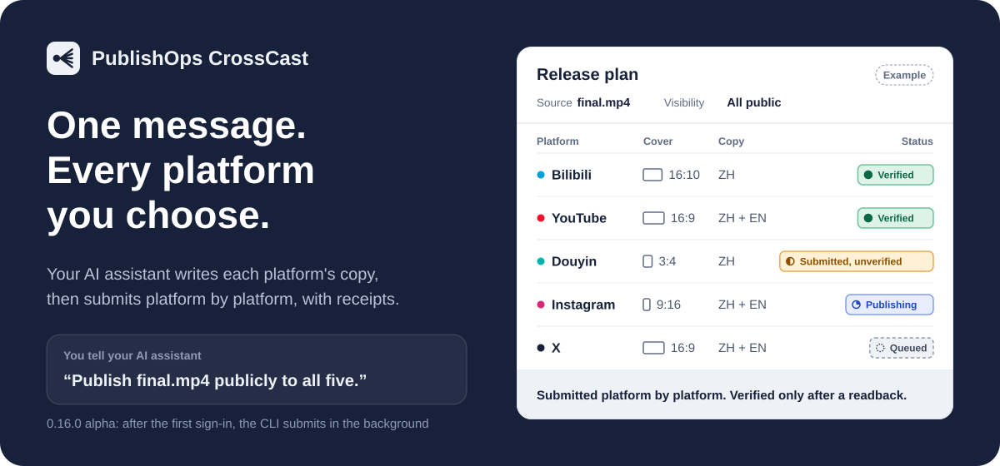
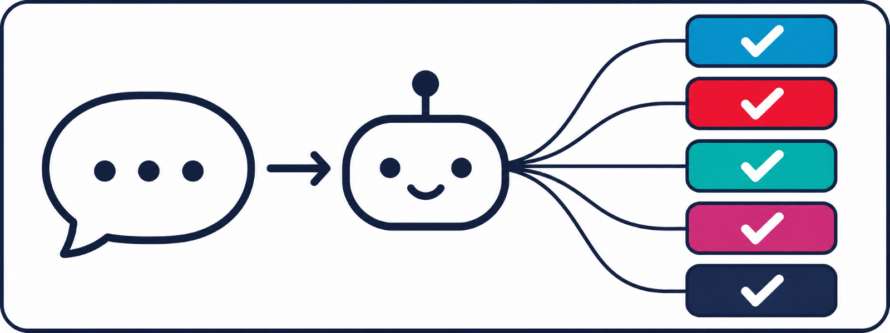

<div align="center">



<br>

<a href="https://github.com/whitecarp/publishops-crosscast/releases"></a>   <a href="LICENSE"></a>

[简体中文](README.md) | [繁體中文](README_ZH_TW.md) | **English**

</div>

## 💡 What it is

You finish a video, and then you still have to write titles for every platform, refit the cover and upload it five times. **CrossCast lets your AI assistant do all of that.** Say one sentence, and it writes the copy, fits the covers and posts to Bilibili, YouTube, Douyin, Instagram and X. After that, edits, comment replies and stats can go through it too.

<p align="center"></p>

> 🎬 Five platforms · 🤖 Works with Codex and Claude Code · 🔑 No extra API key · 🛡️ Safety rails on · 🆓 Free and open source

> **All five platforms have real publishing records.** This is still 0.16.0 alpha, and some features haven't been tried on a real account. The [guide](docs/GUIDE_EN.md#-what-it-does-and-how-far-each-part-has-been-tried) records the tested scope for each version and feature.

## 🚀 Start with one message

**Send this to your AI assistant**, with your own file names and description. It installs itself and walks you through signing in:

```text
Please install https://github.com/whitecarp/publishops-crosscast
Run vpub doctor, and read the skill file it names.
Publish final.mp4 publicly to Bilibili, YouTube, Douyin, Instagram, and X, with cover.jpg as the cover and titles and descriptions written for each platform.
The video is in English, (was / wasn't) made with AI, and is about: (one sentence)
```

The first time on each platform, you scan the QR code or enter the code yourself. After that it publishes in the background.

<details>
<summary>Or install it yourself in a terminal</summary>

```bash
pip install https://github.com/whitecarp/publishops-crosscast/archive/refs/heads/main.zip
vpub doctor              # see what this machine is missing
vpub auth login douyin   # sign in once per platform
```

Requires Python 3.10–3.12 and Google Chrome. Windows is tested; macOS and Linux have not been verified yet. Full steps are in the [guide](docs/GUIDE_EN.md#-install).

</details>

## 🎬 What publishing one video looks like

> **You**: Publish final.mp4 publicly to all five platforms, and keep the titles casual.

```text
✍️  Copy      Simplified Chinese for Bilibili/Douyin, English for YouTube/Instagram/X; original first when translating
🖼️  Covers    Sized for each platform, with your original left alone
🧾  Plan      Where it goes, which account, and who can see it
🔁  Rehearse  Goes through the steps without posting anything
📮  Publish   Posts to each platform in the background, and only counts once it's found there
```

> **AI assistant**: All five platforms are submitted. The ones I can already see on the platform are marked "Verified"; I'll update the ones still in review once they pass. Please change Instagram's cover to the portrait image on your phone.

<sub>An illustration, not a real publication record.</sub>

## ✨ What it does for you

### ✍️ Copy for every platform
Your AI assistant writes titles, descriptions and tags; CrossCast checks them. Bilibili and Douyin use Simplified Chinese; YouTube, Instagram and X use English. When the video's language differs, keep the original first, then the translation. Chinese content on Bilibili and Douyin uses Simplified Chinese only.

### 🖼️ Covers that fit
A new file sized for each platform, with no cropping or stretching, and your original left alone. Douyin and Instagram need a portrait cover: your assistant can draw one, or it can be laid out from your image.

### 📮 Sign in once, then publish in the background
Where supported, schedule posts (except on Instagram), save drafts or stop at a preview, add chapters, and join collections or playlists at upload. Interrupted attempts can resume, but some may need another upload before submission.

### ✏️ Edit after posting
Change titles, descriptions, covers and chapters, depending on the platform. Works CrossCast didn't post can be edited too, once adopted.

### 💬 Comments and messages
Read comments and reply only in the commenter's language, see @ mentions, send single direct messages, like and save, and pin, hide or delete comments. Each action covers only the one thing you asked for, and nothing is sent in bulk.

### 📊 Stats
See your works, views and engagement, and check several platforms at once for new comments and changes in stats. It can also tell you what's unfinished and what to do next.

### 🎛️ Bilibili widgets
Add related-video cards, follow buttons, polls and ratings to your own Bilibili videos.

## 📺 Supported platforms

- **Bilibili**: scan a QR code with the Bilibili app
- **YouTube and Douyin**: sign in once in the Chrome window CrossCast opens
- **Instagram**: sign in the same way; covers change on your phone, and it can't schedule
- **X**: sign in the same way; the account must be subscribed and able to open Media Studio

TikTok is paused. What to know about each platform is in the [guide](docs/GUIDE_EN.md#-platform-support).

## 🆓 Free and paid

Everything above is free and MIT licensed. The paid add-on isn't on sale yet, and you don't need it. It only adds advanced things like official API publishing, operations reports and email reminders. The [full list](docs/GUIDE_EN.md#-free-and-paid) is in the guide.

## 🛡️ Safety rails

It's your own account, so these are on by default:

- ⏱️ **Limits**: daily caps on replies, messages and likes, no repeating the same words to one person, and an AI label
- 🛑 **Stops on a warning**: if a platform asks for verification, or shows a risk check or rate limit, every platform stops until you've dealt with it
- 🔁 **No blind retries**: an unclear submission is checked on the platform, not automatically submitted again
- 🔑 **You do the signing in**: never paste cookies, passwords or codes into a chat
- 🖼️ **Originals untouched**: covers are saved as new files, and your video and image stay as they are

## ❓ FAQ

<details>
<summary>Do I have to approve each release?</summary>

No. Asking it to publish is the authorization: it submits with the platforms, accounts and visibility you named, and only asks again if the content, account, platform, audience or scope changes. To look first, say "don't post yet".

</details>

<details>
<summary>Could my account get banned?</summary>

Automation always carries risk. CrossCast limits its use by default and stops on a verification request, risk check or rate limit until you've dealt with it. A platform may also treat its dedicated browser as a new device and ask you to verify who you are, which you do yourself on the official page.

</details>

<details>
<summary>Is it ready for real releases?</summary>

It's still in testing. Sign-ins expire, platforms may ask for verification at any time, and long unattended runs have not been validated. The first time, you can have your assistant rehearse first and check the plan before posting.

</details>

More questions are in the [guide](docs/GUIDE_EN.md#-faq).

## 📚 Docs

This repo focuses on refining the software itself. Where the project came from, with research and production records, is in [agentic-work-lab](https://github.com/whitecarp/agentic-work-lab).

- [Guide](docs/GUIDE_EN.md): how far each feature has been tried, what to know about each platform, installing and the manual flow
- [Features](docs/FEATURES_EN.md): what each platform supports and how
- [Validation record](docs/VALIDATION_EN.md): real publications and test results for each version
- [Website](https://whitecarp.github.io/publishops-crosscast/?lang=en)
- [Report a problem](https://github.com/whitecarp/publishops-crosscast/issues): remove account details and private information first

Credits: [agentic-work-lab](https://github.com/whitecarp/agentic-work-lab) (development origin) · [bili-cli](https://github.com/kukemc/bili-cli) (Bilibili features; its code is included). Third-party licenses are listed in [NOTICE](NOTICE.md). CrossCast is released under the [MIT License](LICENSE) as an independent integration tool, not an official product of any video platform.
