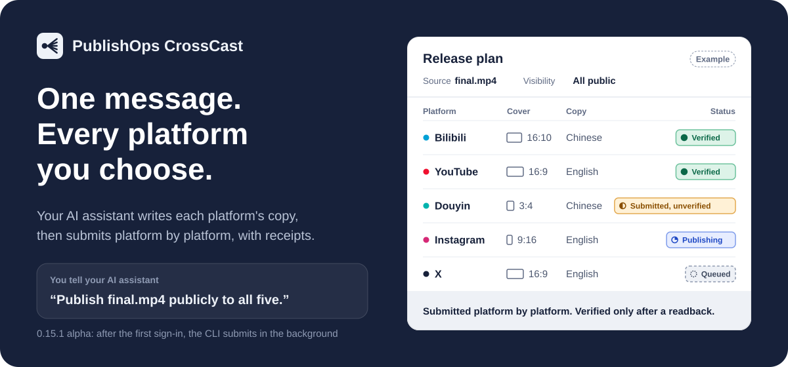

<p align="center">
  <a href="README.md">简体中文</a> · <a href="README_ZH_TW.md">繁體中文</a> · <b>English</b>
</p>

<p align="center">
  
</p>

<h1 align="center">PublishOps CrossCast</h1>

<p align="center">
  <b>One message. Every platform you choose.</b><br>
  Your AI assistant writes each platform's title and description and fits the covers; after the first sign-in, the CLI submits platform by platform in the background and keeps a receipt for every step.
</p>

<p align="center">
  
  
  
  <a href="LICENSE"></a>
</p>

<p align="center">
  <a href="#-start-with-one-message">Quick start</a> ·
  <a href="#-what-it-does-for-you">What it does</a> ·
  <a href="#-platform-support">Platforms</a> ·
  <a href="#-safety-rails">Safety rails</a> ·
  <a href="#-install">Install</a> ·
  <a href="#-faq">FAQ</a> ·
  <a href="https://whitecarp.github.io/publishops-crosscast/?lang=en">Website</a>
</p>

> [!IMPORTANT]
> **0.16.0 alpha.** YouTube, Douyin, Instagram and X have all been published for real and read back, and Bilibili has been uploaded and verified with bili-cli; see the [validation record](docs/VALIDATION_EN.md). It is still alpha: sign-ins expire, platforms may ask for verification at any time, and long unattended runs have not been validated.

## 🚀 Start with one message

Send this to your AI assistant (any assistant that can run commands, such as Codex or Claude Code), replacing `final.mp4` with your video:

```text
Please install https://github.com/whitecarp/publishops-crosscast
Read skills/publishops-crosscast/SKILL.md, then run vpub doctor.
Publish final.mp4 publicly to Bilibili, YouTube, Douyin, Instagram, and X, with titles and descriptions written for each platform.
```

**Have these ready before you start:**

- **Bilibili**: scan a QR code once with the Bilibili app (through bili-cli).
- **YouTube**: free publishing needs an AI assistant with browser tools working in YouTube Studio. CLI publishing through the official API needs the paid API add-on and your own Google desktop OAuth client.
- **Douyin, Instagram and X**: the first sign-in opens CrossCast's own official Chrome window, where you scan a QR code or enter your password and verification code yourself; after that, the CLI reuses the sign-in in the background.
- **X**: publishing works only through Media Studio, so the account must be subscribed and able to open Media Studio.
- **Google Chrome on your computer**: if it's missing, run `vpub setup --install-browser`.

<details>
<summary>Prefer to install it yourself in a terminal?</summary>

```sh
pip install "git+https://github.com/whitecarp/publishops-crosscast.git"
vpub doctor        # check local dependencies
vpub capabilities  # see which publishing routes actually work on this machine
```

Requires Python 3.10–3.12. Neither command signs in or publishes. See [Install](#-install) for sign-in and the manual flow.

</details>

## 🎬 What publishing one video looks like

> **You**: Publish final.mp4 publicly to all five platforms, and keep the titles casual.

| Step | What the AI assistant and vpub do |
| --- | --- |
| ✍️&nbsp;Auto&nbsp;copy | Simplified Chinese for Bilibili and Douyin, English for YouTube, Instagram and X<br>A YouTube category chosen from the video; lengths and tags checked, no external links |
| 🖼️&nbsp;Auto&nbsp;covers | Landscape: 16:10 for Bilibili, 16:9 for YouTube and X<br>Portrait: one portrait image generated by the AI assistant, shared by Douyin and Instagram; the video stays as it is |
| 🧾&nbsp;Auto&nbsp;plan | Platforms, accounts, visibility and AI disclosure listed, plus a confirmation code |
| 🔁&nbsp;Rehearse | One `--dry-run` pass that never touches a platform |
| 📮&nbsp;Submit | After sign-in, videos are submitted automatically in the background |

> **AI assistant**: All five platforms are submitted. Works already read back are marked "Verified"; the ones still in review will be updated once they pass. Please swap the Instagram cover to the portrait image on your phone.

<sub>An illustration, not a real publication record.</sub>

## ✨ What it does for you

### ✍️ Copy written for every platform, automatically

Simplified Chinese for Bilibili and Douyin, English for YouTube, Instagram and X. When the video is in another language, the original text comes first, followed by a translation into the platform's language; Chinese content is written only in Simplified Chinese on Bilibili and Douyin. Your current AI assistant writes the words, while vpub supplies the writing brief and checks lengths and formats. There is no built-in model and no extra model API key. YouTube categories are chosen from the video's content.

### 🖼️ Covers fitted to each platform's canvas, automatically

A separate cover is saved for each platform's canvas with the whole image kept: no cropping, stretching or overwriting the original. Bilibili gets 16:10, YouTube 16:9, and X a landscape cover set through Media Studio. For Douyin and Instagram, the AI assistant (such as Codex) generates one dedicated portrait image that both share, instead of padding a landscape image with black bars. The video itself is never converted to portrait and keeps its original ratio. The Instagram cover is changed on your phone.

### 🧾 A plan before anything moves

Every release starts with a plan that spells out platforms, accounts, visibility and AI disclosure, along with a confirmation code. Change the video, cover or copy and the code changes, so an old confirmation no longer applies and what gets published is exactly the version you approved. A `--dry-run` rehearsal never touches a platform.

### 📮 Sign in once, then publish in the background

After the first sign-in, the CLI does the uploading itself: Bilibili through bili-cli, YouTube through the official API with the paid add-on (otherwise an AI assistant works in YouTube Studio), and Douyin, Instagram and X through a dedicated Chrome the CLI runs in the background. Bilibili and YouTube can also schedule.

### 🔁 Pick up where it stopped

If an upload is interrupted, `vpub resume` continues the original task: YouTube resumes the same upload session, and X continues from the Studio media it already saved. A submission with an unclear result is never clicked again automatically. `vpub status` lists what is unfinished with the exact next command, using local records only, and `vpub cleanup` frees the disk space taken by copies of finished videos.

### 🔍 A receipt for every step

Each platform's progress keeps its real name: Queued → Publishing → Submitted, unverified → Verified. Only a work read back from the platform's page or API counts as "Verified"; a queued task, a sign-in link or a local receipt is not a successful publication.

### ✏️ Edit after posting

`vpub edit` changes a published work in place: YouTube titles and descriptions, Instagram captions, Douyin portrait covers and chapters, and X posts when an Edit option appears. The video and visibility stay the same.

### 💬 Comments, likes and messages

Read comments and reply in the commenter's language, like and save works, read and send direct messages on Douyin, Instagram and X, and check @-mentions. Each action covers only the single item you authorized; nothing is sent in bulk. What's available differs by platform; see the [feature scope](docs/FEATURES_EN.md).

### 📊 Stats and operations reports

See plays and engagement for a single work, scan several platforms for new comments and changes in numbers, and produce an operations report.

### 📧 Email when it needs you (optional)

When a platform needs you to scan a QR code or verify, CrossCast can email you a reminder. Gmail only; off by default and turned on only when you ask.

## 🧭 Platform support

| Platform | Sign-in | Publishing route | Tested |
| --- | --- | --- | --- |
| **Bilibili** | Bilibili app QR code (bili-cli) | bili-cli, can schedule | ✅&nbsp;bili-cli |
| **YouTube** | Free: signed in on YouTube Studio. Paid add-on: Google desktop OAuth client | Free: AI assistant on YouTube Studio. Paid add-on: official API, can schedule | ✅&nbsp;API |
| **Douyin** | Dedicated official Chrome | CLI background browser | ✅&nbsp;Published |
| **Instagram** | Dedicated official Chrome | CLI background browser; cover changed on your phone | ✅&nbsp;Published |
| **X** | Dedicated official Chrome | Media Studio only (subscription required) | ✅&nbsp;Published |
| **TikTok** | — | — | ⏸️&nbsp;Suspended |

See the [validation record](docs/VALIDATION_EN.md) for details. Bilibili uploads were made by the author directly with bili-cli, and `vpub capabilities` still marks Bilibili as untested. These are past real publications: they do not mean publishing will succeed for your account, region and platform status.

**Know before you post**

- **YouTube**: the official API routes, including CLI comments, stats, playlists and edits on YouTube, need the paid API add-on. There is no free CLI background browser for YouTube yet. While the project is in testing mode, add the signing-in account under "Test users" first. Under Google's rules, videos uploaded by an API project created after July 28, 2020 that has not passed Google's audit are locked to private.
- **X**: Media Studio only. The account must be subscribed and able to open Media Studio; accounts without it are limited to 140-second, 512 MB videos, which this tool does not support.
- **Instagram**: the video keeps its original ratio, and the cover must be changed on your phone: open the work's "Edit cover → Add from camera roll", pick the portrait image shared with Douyin, then check how the profile grid crops it.
- **Douyin**: long-term sign-in stability is still being validated, and an interrupted web upload cannot resume, so check existing drafts first.
- **Not available yet**: TikTok (suspended), YouTube cards and clickable end screens, automatic or bulk messages and likes, and full history export.

## 🔒 Safety rails

It's your own account, so these rules are on by default:

- **You decide**: asking it to publish is the authorization. Platforms, accounts and visibility follow what you said, and a platform is never added just because you are signed in to it. If the content, account, platform, audience or scope changes, you are asked again.
- **You sign in yourself**: QR codes, passwords and verification codes are handled by you on the official page. Never paste cookies, passwords, verification codes or tokens into chats, logs or the repository.
- **No duplicate uploads**: the same video is submitted only once to the same platform account; if a result is unclear, it is only read back and checked, never uploaded again.
- **Stops at risk controls**: on a verification code, risk control or rate limit, publishing stops and waits for you.
- **One thing at a time**: only one publishing task runs at once, and comments and messages send only the single item you authorized.
- **Originals untouched**: fitted covers are saved as new files; your original video and image stay as they are.

## 🤝 Who does what

- **You**: say which platforms, accounts and visibility to publish to; scan QR codes or enter codes at the first sign-in, and change the Instagram cover on your phone. Your message is the authorization; you are asked again if the scope changes.
- **AI assistant**: reads `SKILL.md`, writes copy and replies for each platform, generates the portrait cover image, and runs vpub for you.
- **vpub**: builds and checks plans and fits covers; after the first sign-in it submits in the background through bili-cli, the official API and a dedicated Chrome, keeps receipts and reads results back. It does not sign in for you or approve content for you.
- **Platform**: handles sign-in, review, final publication and visibility; features, format limits and fees follow the official page on the day.

## 📦 Install

Requires Python 3.10–3.12 and Google Chrome. The Windows installer has been tested; macOS and Linux have not been validated.

**Windows installer**

```powershell
git clone https://github.com/whitecarp/publishops-crosscast.git
cd publishops-crosscast
powershell -ExecutionPolicy Bypass -File .\install.ps1
```

The script prints the full path to `vpub.exe` but does not add it to PATH. Use that path directly, or run commands from the virtual environment the script creates.

**pip from Git** (requires Git and a compatible Python)

```sh
pip install "git+https://github.com/whitecarp/publishops-crosscast.git"
vpub doctor
vpub onboard --platforms bilibili,douyin,youtube
```

**Sign in to each platform**

```sh
vpub auth login youtube --method api --client-json /path/to/client.json  # paid API add-on
vpub auth login douyin
vpub auth login instagram
vpub auth login x
vpub auth status all
```

Keep the YouTube OAuth client JSON and sign-in tokens on your machine; never commit them to GitHub.

<details>
<summary><b>Prefer to drive it yourself? A look at the manual flow</b></summary>

```sh
vpub init --video final.mp4 --language en --out publish.json --platforms bilibili,douyin,youtube
vpub metadata request publish.json --source script.txt --out request.json
vpub metadata apply publish.json --request request.json --response response.json --out localized.json
vpub covers prepare localized.json --source cover.jpg --portrait portrait.jpg --out-dir covers --out ready.json
vpub plan ready.json
vpub publish ready.json --dry-run
vpub publish ready.json --confirm <confirmation-code>
vpub verify RECEIPT_KEY
```

`--dry-run` does not upload. Your AI assistant writes `response.json` following the template inside `request.json`. After an interruption, continue with `vpub resume RECEIPT_KEY`; `vpub receipts` lists every receipt.

</details>

## 💰 Costs and privacy

- **Model:** CrossCast itself needs no extra model API; your current AI assistant writes the copy.
- **Possible costs:** your AI assistant's subscription, an X subscription (publishing needs Media Studio), and YouTube API quota (set by Google). Free or unlimited use is not promised.
- **Local data:** sign-in sessions, tasks, settings and receipts live in the local application data directory. Do not commit them to GitHub. Before sharing manifests, screenshots or logs, remove account identifiers, work IDs, private paths and credentials.
- **Secrets:** never paste cookies, verification codes, passwords, tokens or OAuth files into chats, logs or the repository.

## ❓ FAQ

<details>
<summary><b>Do I have to approve each release?</b></summary>

No. Asking it to publish is the authorization: it submits with the platforms, accounts and visibility you named, and only asks again if the content, account, platform, audience or scope changes. To look first, say "don't post yet", or run a `--dry-run`.

</details>

<details>
<summary><b>Does YouTube need an OAuth client?</b></summary>

Only on the paid API route, where an API key on its own cannot authorize uploads. The free route has an AI assistant with browser tools publish through YouTube Studio, with no OAuth client. You authorize once on Google's page with a "Desktop app" OAuth client; it happens on your own computer, and the token stays there.

</details>

<details>
<summary><b>Can I post to X without a subscription?</b></summary>

No. CrossCast publishes to X only through Media Studio, so the account must be subscribed and able to open Media Studio. Paying or signing in doesn't guarantee Media Studio access, so it is checked before uploading.

</details>

<details>
<summary><b>Why does the Instagram cover have to be changed on a phone?</b></summary>

In testing, the portrait image shared with Douyin could only be applied through the phone app's "Edit cover → Add from camera roll". Your AI assistant prepares the image; you do the step on your phone.

</details>

<details>
<summary><b>Can I publish videos that aren't AI-generated?</b></summary>

Yes. Tell your AI assistant whether the video is AI-generated: if it is, each platform's AI-content declaration is ticked; if not, it is published as an ordinary video without an AI label.

</details>

<details>
<summary><b>If I only run vpub in a terminal, can it publish?</b></summary>

Yes. After the first sign-in, the CLI does the uploading in the background, with no AI assistant stepping through a browser. When a sign-in expires or a platform asks for verification, you need to handle it on the official page.

</details>

<details>
<summary><b>What if a submission result is unclear?</b></summary>

Use `vpub verify` to read it back, or `vpub resume` to continue the original task; do not blindly upload again. `vpub receipts` shows the local receipts, but a receipt on its own is not platform evidence.

</details>

## 📚 Docs and credits

| | |
| --- | --- |
| 🧭 [Feature scope](docs/FEATURES_EN.md) | What each platform supports and how |
| ✅ [Validation record](docs/VALIDATION_EN.md) | Real publications and test results for each version |
| 🐦 [X Media Studio guide](docs/X_GUIDE_EN.md) | Uploading, covers and publishing on X |
| 🌐 [Website](https://whitecarp.github.io/publishops-crosscast/?lang=en) | Project overview page |
| 🐞 [Report an issue](https://github.com/whitecarp/publishops-crosscast/issues) | Feedback (remove account and private details first) |

Credits: [agentic-work-lab](https://github.com/whitecarp/agentic-work-lab) (development origin) · [bili-cli](https://github.com/kukemc/bili-cli) (Bilibili features; its code is included). Third-party licenses are listed in [NOTICE](NOTICE.md). CrossCast is released under the [MIT License](LICENSE) as an independent integration tool, not an official product of any video platform.
