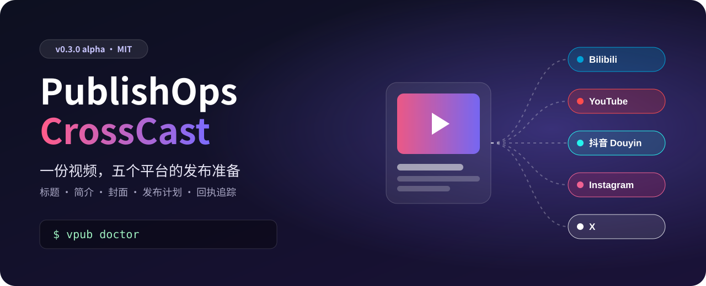

<p align="center"></p>

# PublishOps CrossCast

[简体中文](README.md) · [繁體中文](README_ZH_TW.md) · [English](README_EN.md)

**0.3.0 alpha** · Python 3.10–3.12 · [MIT 授權](LICENSE)

讓 AI 助手把一支影片整理成適合多個平台的發布方案，並在你確認後協助完成官方網頁發布。

**一句話開始：** 把下面這段交給你的 AI 程式助手：

> 安裝 https://github.com/whitecarp/publishops-crosscast，讀取 `skills/publishops-crosscast/SKILL.md`，執行 `vpub doctor`。先幫我準備草稿；由我選擇平台、帳號和公開範圍，再繼續。

```text
使用者：先替這支影片準備發布草稿，不要發布。平台由我選。
AI：我會檢查檔案並建立方案。你確認平台、帳號和公開範圍後，我再開啟官方頁面供你核對。
使用者：選 YouTube，保持私人。先讓我看標題和說明。
AI：草稿已準備。請核對文案與帳號；目前尚未提交。
```

以上是**流程示意**，不是實際發布記錄。CrossCast 預設先準備方案；CLI 不會替你確認內容，也不會把待辦或登入連結說成已發布。沒有可操作瀏覽器的宿主，無法完成需要網頁互動的平台發布。

## 支援範圍

- **Bilibili**：預設由宿主操作官方網頁；亦可選用上游 `bili` CLI。
- **YouTube**：官方網頁流程；可選 YouTube API，用於明確設定的功能。
- **Douyin**：官方網頁流程；獨立後端仍屬實驗階段。
- **Instagram、X**：由宿主協助操作官方網頁。可準備草稿；發布或修改需依流程授權。
- **TikTok**：目前暫停支援。

目前沒有通用評論、私訊、收件匣或創作者數據命令。詳見[平台說明](docs/PLATFORMS_ZH_TW.md)。

## 安裝

需要 Python 3.10–3.12。Windows 安裝腳本已實測；macOS、Linux 尚未驗收。

```powershell
git clone https://github.com/whitecarp/publishops-crosscast.git
cd publishops-crosscast
powershell -ExecutionPolicy Bypass -File .\install.ps1
```

腳本會列印 `vpub.exe` 完整路徑，但不會加入 PATH。可直接使用該路徑，或在安裝腳本建立的虛擬環境中執行命令。也可用 pip 從 Git 安裝（需要 Git 與相容的 Python）：

```sh
pip install "git+https://github.com/whitecarp/publishops-crosscast.git"
vpub doctor
```

## 常見問題

**需要另外購買模型 API 嗎？** 不需要為 CrossCast 本身另購模型 API。AI 文案由宿主對話模型處理。若選擇 YouTube API，需自行設定 Google OAuth；宿主訂閱、平台功能或選配 API 可能另有費用，本專案不保證免費。

**它會自動發布嗎？** 預設 `native` 網頁流程需要具備瀏覽器操作能力的宿主。完成設定與授權後，Bilibili CLI 或 YouTube API 流程可由 CLI 直接提交；實際後端以方案與 `vpub capabilities` 為準。沒有瀏覽器工具的助手無法代你完成網頁流程。

**安裝後就能操作五個平台嗎？** 不一定。各平台需要相應帳號狀態、功能權限與宿主瀏覽器能力；請先看[平台邊界](docs/PLATFORMS_ZH_TW.md)。

## 進階

[使用指南](docs/USAGE_ZH_TW.md) · [平台範圍](docs/PLATFORMS_ZH_TW.md) · [English](README_EN.md) · [简体中文](README.md) · [線上介紹](https://whitecarp.github.io/publishops-crosscast/) · [回報問題](https://github.com/whitecarp/publishops-crosscast/issues)

來源鳴謝：[ai-video-lab](https://github.com/whitecarp/ai-video-lab)（開發來源與說明）· [bili-cli](https://github.com/kukemc/bili-cli)（Bilibili 上游工具）。詳見[NOTICE](NOTICE.md)。
