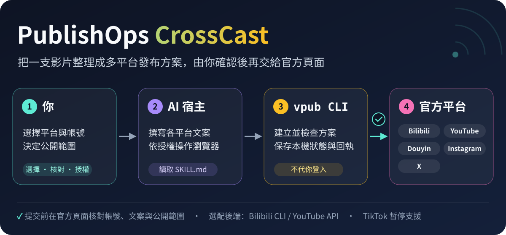

<p align="center">
  <a href="README.md">简体中文</a> · <b>繁體中文</b> · <a href="README_EN.md">English</a>
</p>

<p align="center">
  
</p>

<h1 align="center">PublishOps CrossCast</h1>

<p align="center">
  <b>一句話，發往你選的所有平台。</b><br>
  你的 AI 助手為每個平台寫好標題和簡介、調整好封面；首次登入之後，CLI 在背景逐一到各平台提交，每一步都留下回執。
</p>

<p align="center">
  
  
  
  <a href="LICENSE"></a>
</p>

<p align="center">
  <a href="#-一句話開始">一句話開始</a> ·
  <a href="#-它能幫你做什麼">能做什麼</a> ·
  <a href="#-平台支援">平台支援</a> ·
  <a href="#-安全護欄">安全護欄</a> ·
  <a href="#-安裝">安裝</a> ·
  <a href="#-常見問題">常見問題</a> ·
  <a href="https://whitecarp.github.io/publishops-crosscast/?lang=zh-TW">線上介紹</a>
</p>

> [!IMPORTANT]
> **0.15.1 alpha。** YouTube、抖音、Instagram、X 都已真實發布並讀回過，B站也用 bili-cli 上傳並核驗過，詳見[驗證記錄](docs/VALIDATION.md)。它仍是 alpha：登入會過期，平台也可能臨時要求驗證，長時間無人值守還沒驗收。

## 🚀 一句話開始

把下面這段話交給你的 AI 助手（Codex、Claude Code 這類能執行指令的助手都可以），並把 `final.mp4` 換成你的影片：

```text
請安裝 https://github.com/whitecarp/publishops-crosscast
讀取 skills/publishops-crosscast/SKILL.md，然後執行 vpub doctor。
把 final.mp4 公開發布到 B站、YouTube、抖音、Instagram 和 X，標題和簡介依平台來寫。
```

**開始前準備好這幾樣：**

- **B站**：用 B站 App 掃碼登入一次（透過 bili-cli）。
- **YouTube**：CLI 走官方 API；沒設定時，能操作瀏覽器的 AI 助手可以在 YouTube Studio 上發布。YouTube 沒有 CLI 背景瀏覽器路徑。在 Google Cloud 啟用 YouTube Data API v3，建立一個「桌面應用程式」OAuth 用戶端，把下載的 JSON 交給 AI 助手。
- **抖音、Instagram、X**：第一次會開啟 CrossCast 專用的官方 Chrome 視窗，由你自己掃碼或輸入密碼、驗證碼；之後 CLI 在背景沿用這個登入。
- **X 瀏覽器路徑**：只能用 Media Studio 發布，帳號必須已訂閱並能進入 Media Studio。
- **電腦上要有 Google Chrome**：沒有的話，執行 `vpub setup --install-browser` 安裝。

<details>
<summary>想自己在終端機裡安裝？</summary>

```sh
pip install "git+https://github.com/whitecarp/publishops-crosscast.git"
vpub doctor        # 檢查本機相依套件
vpub capabilities  # 查看本機實際能走的發布方式
```

需要 Python 3.10–3.12。這兩個指令都不會登入或發布。登入和手動流程見[安裝](#-安裝)。

</details>

## 🎬 發一支影片是什麼樣子

> **你**：把 final.mp4 公開發到這五個平台，標題口語一點。

| 步驟 | AI 助手和 vpub 在做什麼 |
| --- | --- |
| ✍️ 自動寫文案 | B站、抖音寫簡體中文，YouTube、Instagram、X 寫英文<br>YouTube 依影片內容選好類別；長度、標籤都檢查過，不夾帶外部連結 |
| 🖼️ 自動調封面 | 橫式：B站 16:10，YouTube、X 16:9<br>直式：AI 助手自動產生一張直式圖，抖音和 Instagram 共用；影片保持原樣 |
| 🧾 自動出方案 | 列清平台、帳號、公開範圍和 AI 聲明，產生確認碼 |
| 🔁 先預演 | `--dry-run` 跑一遍，不碰平台 |
| 📮 背景提交 | 登入後自動在背景提交影片 |

> **AI 助手**：五個平台都提交好了。已經讀回到作品的標成「已核驗」，還在審核的，通過後我再更新。Instagram 的封面請在手機上換成那張直式圖。

<sub>流程示意，不是實際發布記錄。</sub>

## ✨ 它能幫你做什麼

### ✍️ 自動寫好每個平台的文案

B站、抖音用簡體中文，YouTube、Instagram、X 用英文。影片本身是別的語言時，先保留原文，再附上平台語言的譯文；中文內容在 B站、抖音只寫簡體。文案由你正在用的 AI 助手來寫，vpub 提供寫作要求並檢查長度和格式，不內建模型，也不需要另外設定模型 API Key。YouTube 的類別依影片內容來選。

### 🖼️ 封面自動調整成各平台畫布

依各平台畫布另存封面，完整保留畫面，不裁切、不拉伸、不覆蓋原圖：B站 16:10，YouTube 16:9，X 透過 Media Studio 設定橫式封面。抖音和 Instagram 的直式封面，由 AI 助手（例如 Codex）自動產生一張專用直式圖，兩邊共用，不會拿橫式圖加黑邊湊數。影片本身不轉成直式，保留原比例。Instagram 的封面要在手機上換。

### 🧾 先出方案，再動手

每次發布先產生一份方案：平台、帳號、公開範圍和 AI 聲明都寫得清清楚楚，並產生一個確認碼。影片、封面或文案一改，確認碼就變，舊的確認自動作廢，保證發出去的就是你確認過的那一版。`--dry-run` 預演不會碰平台。

### 📮 登入一次，之後背景發布

首次登入之後，CLI 自己完成上傳：B站走 bili-cli，YouTube 走官方 API，抖音、Instagram、X 由 CLI 在背景操作專用的 Chrome。B站和 YouTube 也支援排程發布。

### 🔁 中斷了也能接著做

上傳途中斷線，`vpub resume` 接著原本的任務繼續：YouTube 從同一個上傳工作階段續傳，X 接著已經存好的 Studio 素材。結果不明的提交不會自動再按一次。

### 🔍 每一步都有回執

每個平台的進度都叫它本來的名字：排隊中 → 發布中 → 已提交，待核驗 → 已核驗。只有從平台頁面或 API 讀回到作品，才算「已核驗」；排隊、登入連結和本機回執都不等於發布成功。

### ✏️ 發出去還能改

`vpub edit` 直接修改已發布的作品：YouTube 的標題和簡介、Instagram 的貼文說明、抖音的直式封面和章節，X 在出現編輯入口時也能改。不換影片，不改公開範圍。

### 💬 留言、按讚和私訊

讀取留言、用留言者的語言回覆，按讚、收藏，在抖音、Instagram、X 上讀寫私訊，查看 @ 提及。每次只做你授權的那一則，不會自動群發。各平台能做的不一樣，詳見[功能範圍](docs/FEATURES.md)。

### 📊 數據和營運報告

查看單支作品的播放和互動，巡檢多個平台的新留言和數據變化，產生一份營運報告。

### 📧 需要你時寄信提醒（可選）

平台要你掃碼或驗證時，可以寄一封提醒信給你。只支援 Gmail，預設關閉，你主動要求時才開啟。

## 🧭 平台支援

| 平台 | 登入 | 發布方式 | 實測記錄 |
| --- | --- | --- | --- |
| **Bilibili** | B站 App 掃碼（bili-cli） | bili-cli，可排程發布 | ✅ bili-cli |
| **YouTube** | Google 桌面 OAuth 用戶端 | 預設走官方 API，可排程發布；也可由 AI 助手操作 YouTube Studio | ✅ API |
| **抖音** | 專用官方 Chrome | CLI 背景瀏覽器 | ✅ 已發布 |
| **Instagram** | 專用官方 Chrome | CLI 背景瀏覽器，封面在手機上改 | ✅ 已發布 |
| **X** | 專用官方 Chrome | 只能用 Media Studio（需訂閱） | ✅ 已發布 |
| **TikTok** | — | — | ⏸️ 暫停 |

實測記錄見[驗證記錄](docs/VALIDATION.md)。B站是作者直接用 bili-cli 上傳的，`vpub capabilities` 裡 B站仍標為未實測。這些是過去的真實發布，不代表在你的帳號、地區和平台狀態下一定成功。

**發布前需要知道**

- **YouTube**：CLI 走官方 API；沒設定時，能操作瀏覽器的 AI 助手可以在 YouTube Studio 上發布。YouTube 沒有 CLI 背景瀏覽器路徑。專案還在測試模式時，要先把登入用的帳號加進「測試使用者」；依 Google 的規定，2020 年 7 月 28 日之後建立、又沒通過審查的 API 專案，上傳的影片會被鎖定為私人。
- **X 瀏覽器路徑**：只能用 Media Studio。帳號必須已訂閱並能進入 Media Studio；未訂閱帳號的影片上限是 140 秒、512 MB，本工具不支援。
- **Instagram**：影片保留原比例；封面必須在手機上改：開啟作品的「編輯封面 → 從相機膠卷新增」，選和抖音共用的那張直式圖，再看一下個人檔案格狀版面的裁切。
- **抖音**：長時間維持登入的穩定性還在驗收；網頁上傳中斷後不能續傳，要先檢查既有的草稿。
- **還沒有的**：TikTok（暫停）、YouTube 資訊卡和可點擊片尾、自動或大量私訊與按讚、完整歷史匯出。

## 選用 X／Instagram API 路徑（實驗性）

API 程式碼維持 MIT 公開授權，包含 `api_backends.py` 與測試。CrossCast 不設授權金鑰或付費解鎖；平台的開發者權限、審查與費用另計。

X／Instagram 預設仍使用已登入的背景瀏覽器。新增 API 上傳路徑**目前僅通過離線故障注入測試，尚未完成真實帳號授權與上傳驗收**；既有發布實測指的是瀏覽器路徑。API 目前涵蓋授權、上傳、發布與讀回，留言、收藏與私訊命令保留原有後端。

- **X API：**建立支援 OAuth 2.0 使用者授權的開發者應用，開啟所需媒體與貼文權限。將 `client_id`、適用時的 `client_secret` 存在私人 JSON。開發者 API 權限與計費不同於一般訂閱及 Media Studio 權限。
- **Instagram API：**此實作使用 Facebook Login for Business，需連結 Facebook 粉絲專頁的 Instagram 專業帳號。將 `app_id`、`app_secret` 與選填的 `ig_user_id` 存在私人 JSON；權限與審查依 Meta 應用設定而定。
- 在應用登記 `http://127.0.0.1:8765/callback`，執行對應命令並自行完成官方授權，再於方案對應平台指定 `"method": "api"`。憑證與權杖只留在私人目錄。

```sh
vpub auth login x --method api --client-json /private/x-client.json
vpub auth login instagram --method api --client-json /private/instagram-client.json
```

這兩條 API 路徑尚不套用自訂封面、排程或草稿。X 處理等待有上限，恢復時檢查原媒體。Instagram 已完成的容器不重傳；中斷後若伺服器未回傳已確認偏移量便停止，實際偏移量行為仍待帳號實測。發布結果不明時，多次恢復也不重送；取得作品 ID 後先落盤再讀回。帳號改變會停止原任務。

協定參考：[X 分段上傳](https://docs.x.com/x-api/media/quickstart/media-upload-chunked)、[Meta 內容發布](https://developers.facebook.com/docs/instagram-platform/content-publishing/)。

## 🔒 安全護欄

用的是你自己的帳號，所以這些規則預設就開著：

- **你說了算**：你說要發布就是授權，平台、帳號和公開範圍都依你說的來，不會因為某個平台已登入就順手加上。內容、帳號、平台、受眾或任務範圍改變了，會再問你。
- **登入你自己來**：掃碼、密碼和驗證碼都在官方頁面由你本人完成。不要把 Cookie、密碼、驗證碼或權杖貼進對話、日誌或儲存庫。
- **不重複上傳**：同一支影片在同一個平台帳號只提交一次；結果不明時只讀回核對，不會再傳一次。
- **碰到風控就停**：遇到驗證碼、風控或限流，發布立刻停下，等你處理。
- **一次只做一件事**：同一時間只有一個發布任務在跑；留言和私訊每次只發你授權的那一則。
- **原素材不動**：調整後的封面另存為新檔案，原影片和原圖保持原樣。

## 🤝 誰負責什麼

- **你**：說清要發的平台、帳號和公開範圍；第一次登入時掃碼或輸入驗證碼，在手機上改 Instagram 封面。這句話就是授權；範圍改變時會再問你。
- **AI 助手**：讀取 `SKILL.md`，依平台寫文案和回覆，產生直式封面圖，替你執行 vpub。
- **vpub**：建立並檢查方案、調整封面，首次登入後在背景呼叫 bili-cli、官方 API 和專用 Chrome 完成提交，保存回執並讀回核對；不替你登入，也不替你確認內容。
- **平台**：負責帳號登入、審核、最終發布與公開；功能、格式限制和收費以當日官方頁面為準。

## 📦 安裝

需要 Python 3.10–3.12 和 Google Chrome。Windows 安裝腳本已經實測；macOS、Linux 尚未驗收。

**Windows 安裝腳本**

```powershell
git clone https://github.com/whitecarp/publishops-crosscast.git
cd publishops-crosscast
powershell -ExecutionPolicy Bypass -File .\install.ps1
```

腳本會印出 `vpub.exe` 的完整路徑，但不會把它加入 PATH。可以直接使用該路徑，或在腳本建立的虛擬環境中執行指令。

**透過 pip 從 Git 安裝**（需要 Git 和相容的 Python）

```sh
pip install "git+https://github.com/whitecarp/publishops-crosscast.git"
vpub doctor
vpub onboard --platforms bilibili,douyin,youtube
```

**登入各平台**

```sh
vpub auth login youtube --method api --client-json /path/to/client.json
vpub auth login douyin
vpub auth login instagram
vpub auth login x
vpub auth status all
```

YouTube 的 OAuth 用戶端 JSON 和登入權杖只留在本機，不要提交到 GitHub。

<details>
<summary><b>想自己動手？看一眼手動流程</b></summary>

```sh
vpub init --video final.mp4 --language zh-Hant --out publish.json --platforms bilibili,douyin,youtube
vpub metadata request publish.json --source script.txt --out request.json
vpub metadata apply publish.json --request request.json --response response.json --out localized.json
vpub covers prepare localized.json --source cover.jpg --portrait portrait.jpg --out-dir covers --out ready.json
vpub plan ready.json
vpub publish ready.json --dry-run
vpub publish ready.json --confirm <確認碼>
vpub verify RECEIPT_KEY
```

`--dry-run` 不會上傳。`response.json` 由 AI 助手依 `request.json` 中的範本撰寫。中斷後用 `vpub resume RECEIPT_KEY` 接著做，用 `vpub receipts` 查看所有回執。

</details>

## 💰 費用與隱私

- **模型**：CrossCast 本身不需要另外購買模型 API，文案由你正在用的 AI 助手完成。
- **可能的費用**：AI 助手的訂閱、X 的訂閱（發布要用 Media Studio），以及 YouTube API 的配額（由 Google 決定）。本專案不承諾免費或無限使用。
- **本機資料**：登入工作階段、任務、設定和回執都保存在本機應用程式資料目錄，請不要提交到 GitHub。分享清單、截圖或日誌前，先移除帳號識別資訊、作品 ID、私人路徑和憑證。
- **敏感資訊**：不要在對話、日誌或儲存庫中提供 Cookie、驗證碼、密碼、權杖或 OAuth 檔案。

## ❓ 常見問題

<details>
<summary><b>發布前還要我再確認嗎？</b></summary>

不用。你說要發布，就是授權：它依你說的平台、帳號和公開範圍提交。只有內容、帳號、平台、受眾或任務範圍變了，才會再問你。想先看一眼，就說「先別發」，或者用 `--dry-run` 預演。

</details>

<details>
<summary><b>為什麼 YouTube 一定要設定 OAuth 用戶端？</b></summary>

CLI 透過官方 API 發布到 YouTube，而 API 金鑰本身不能授權上傳，必須用「桌面應用程式」OAuth 用戶端在 Google 頁面授權一次。授權在你自己的電腦上完成，權杖只留在本機。

</details>

<details>
<summary><b>X 沒訂閱能發嗎？</b></summary>

不能。預設瀏覽器路徑只透過 Media Studio 發布 X，帳號必須已訂閱並能進入 Media Studio。付了費或登入了，不代表 Media Studio 已經開通，上傳前會先核對。

</details>

<details>
<summary><b>Instagram 的封面為什麼要在手機上改？</b></summary>

實測下來，要在手機 App 裡「編輯封面 → 從相機膠卷新增」才能換上和抖音共用的直式圖。AI 助手會準備好這張圖，手機上的操作由你完成。

</details>

<details>
<summary><b>能發布不是 AI 生成的影片嗎？</b></summary>

能。告訴 AI 助手影片是不是 AI 生成的：是的話，各平台都會勾選 AI 生成內容聲明；不是的話，就以一般影片發布，不加 AI 標示。

</details>

<details>
<summary><b>只在終端機裡執行 vpub，能直接發出去嗎？</b></summary>

能。首次登入之後，CLI 自己在背景完成上傳，不需要 AI 助手一步步操作瀏覽器。登入過期或平台要求驗證時，需要你回到官方頁面處理。

</details>

<details>
<summary><b>提交結果不確定怎麼辦？</b></summary>

用 `vpub verify` 讀回核對，或用 `vpub resume` 接著原本的任務，不要盲目重新上傳。本機回執可以用 `vpub receipts` 查看，但它本身不代替平台證據。

</details>

## 📚 文件與鳴謝

| | |
| --- | --- |
| 🧭 [功能範圍](docs/FEATURES.md) | 各平台能做什麼、用什麼方式做 |
| ✅ [驗證記錄](docs/VALIDATION.md) | 每個版本的真實發布與測試結果 |
| 🐦 [X Media Studio 流程](docs/X_GUIDE.md) | X 的上傳、封面與發布步驟 |
| 🌐 [線上介紹](https://whitecarp.github.io/publishops-crosscast/?lang=zh-TW) | 專案概覽頁 |
| 🐞 [回報問題](https://github.com/whitecarp/publishops-crosscast/issues) | 問題回饋（請先移除帳號與私密資訊） |

來源鳴謝：[agentic-work-lab](https://github.com/whitecarp/agentic-work-lab)（開發來源）· [bili-cli](https://github.com/kukemc/bili-cli)（Bilibili 上游工具）。第三方授權詳見 [NOTICE](NOTICE.md)。CrossCast 以 [MIT 授權](LICENSE) 發布，是獨立整合工具，並非任何影音平台的官方產品。
